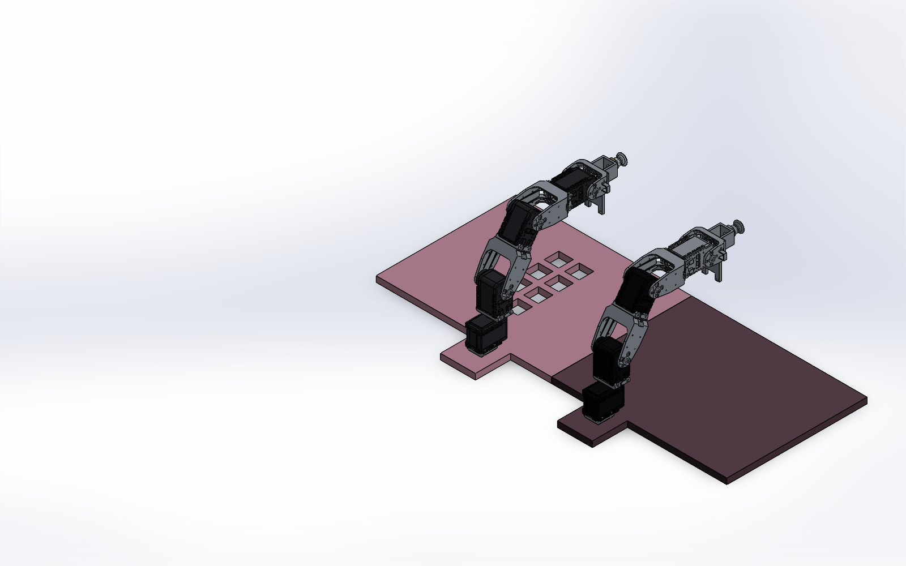
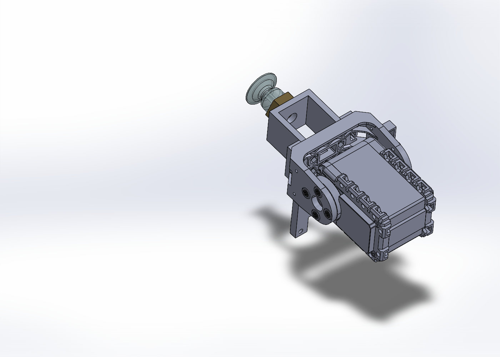

# AX-12A 雙臂 3D 組合

兩隻四軸機械臂，分別安裝於 `平台_2` 與 `平台_3`。兩平台左右並排、側邊相接，合計 8 顆 AX-12A。

- [SolidWorks 總組合](雙臂_交付/完成_雙臂總組合.sldasm)：解壓或複製後保留整個 `雙臂_交付` 資料夾，從此檔開啟。
- [STEP 交換檔](雙臂_交付/雙臂總組合.STEP)
- [完整 ZIP](雙臂_含螺絲墊片_完整包.zip)
- [組裝與五金說明](雙臂_交付/開啟說明與五金清單.txt)
- [驗證紀錄](雙臂_交付/驗證紀錄.txt)

此模型是參考照片建立的固定姿態，肩部與肘部輸出盤角度約為 35°、55°。五金含依模型槽位製作的薄螺帽與小外徑墊片；實際製作前需核對尺寸、公差和負載。SolidWorks 干涉檢查仍列出原支架卡扣配合處及簡化螺紋鎖入段的重疊，詳見說明檔。

## 平台3整組更新（2026-11-06）

左臂平台已改用提供的 `平台_3new.SLDPRT`，以原引用檔名儲存。左右臂、末端子組合與總組合已重建並儲存，STEP、兩組預覽及完整 ZIP 已同步更新。

新平台外形包絡仍為 300 × 10 × 300 mm，四個主要安裝孔中心保持不變，孔徑由 2.1 改為 2.2 mm；沿用原裝配定位。重新開啟總組合錯誤／警告均為 0，未解析引用與包外引用均為 0。新平台及雙臂間干涉均為 0；整組仍有 182 處模型重疊（含原卡扣與簡化螺紋鎖入段），詳見驗證紀錄。

## 末端吸盤更新（2026-11-06）

兩臂的原吸盤支架前端各新增一組吸盤，與原中央 Ø6 mm 孔同軸，底座貼合支架外表面。共用末端子組合、左右臂、總組合、STEP 和完整包均已更新。

- 六角底座：對邊 **15 mm**、對角約 17.32 mm，高 6 mm。
- 吸盤：高 14 mm，與底座合計 **20 mm**。
- 吸口外徑暫定 18 mm，依參考照片比例建模；中央通道暫定 Ø3 mm。
- 模型含六角金屬底座與半透明中空吸盤兩個實體，保留可編輯拉伸／旋轉特徵。
- 沿用既有固定姿態裝配。照片中的側接頭、實際螺紋與密封件未細化；本模型用於外形及裝配配置。

兩個吸盤安裝面位置及軸線誤差均為 0，新增吸盤干涉 0；重新開啟總組合錯誤／警告均為 0。原組合既有的 182 處卡扣／簡化鎖入段重疊仍保留。

[吸盤零件](雙臂_交付/完成_吸盤_六角對邊15_總高20.SLDPRT) · [末端近照](雙臂_交付/吸盤末端預覽.png)

